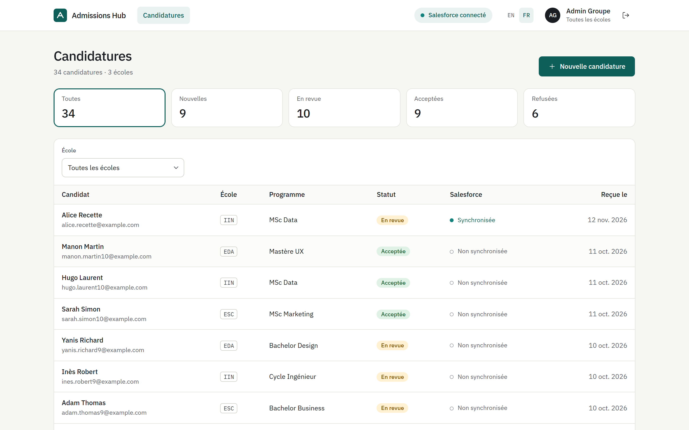
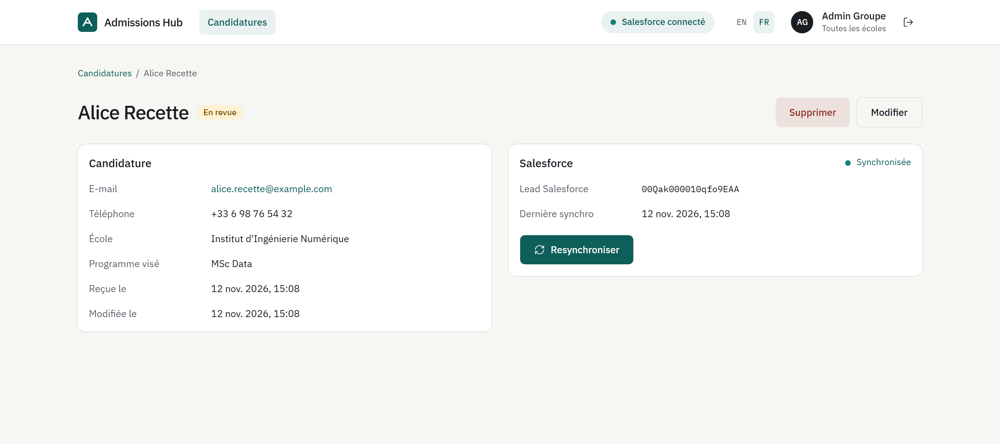
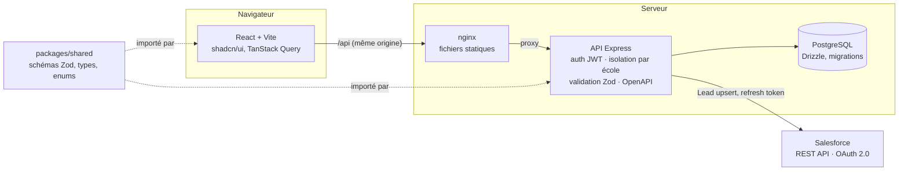

# Admissions Hub

[English](README.md) · **Français**

Portail interne qui centralise les candidatures de plusieurs écoles et les synchronise avec Salesforce.
Chaque administrateur ne voit que son école ; l'administrateur groupe voit tout et pousse les candidats en Leads.

[](https://github.com/Lachetquentin/admissions-hub/actions/workflows/ci.yml)

**Démo : <https://admissions-hub.onrender.com>** — `groupe@admissions.test` / `admissions-demo`
(ou `esc@`, `iin@`, `eda@admissions.test` pour un admin d'école). Salesforce y est désactivé ;
la première requête peut prendre ~30 s (hébergement gratuit en veille).





## Fonctionnalités

- **Multi-écoles** : rôles `GROUP_ADMIN` (toutes les écoles) et `SCHOOL_ADMIN` (son école). L'isolation est appliquée par l'API : un admin d'école qui demande la candidature d'une autre école reçoit **404**.
- **Candidatures** : liste paginée, compteurs par statut qui servent de filtre, filtre par école, création, édition, suppression avec confirmation. Validation par les mêmes schémas Zod côté front et API.
- **Salesforce** : connexion de l'org par OAuth 2.0 Web Server Flow (PKCE), tokens chiffrés en base, rafraîchissement automatique, synchronisation idempotente de chaque candidature en **Lead**, erreurs Salesforce lisibles.
- **Bilingue** : interface en français et en anglais (react-i18next), langue du navigateur par défaut, sélecteur FR / EN mémorisé.
- **API documentée** : OpenAPI 3.1 générée depuis les schémas Zod, Swagger UI sur `/docs`.

## Architecture



Synchronisation d'une candidature : machine à états `NOT_SYNCED → PENDING → SYNCED | FAILED`
documentée dans [`docs/STATE_MACHINES.md`](docs/STATE_MACHINES.md).

## Lancer en local

Prérequis : Docker. Pour développer : Node.js 22+ (24 recommandé).

**Tout en un** (migrations et données de démo comprises) :

```bash
docker compose up --build
```

→ <http://localhost:8080>. Les comptes de démo sont listés sur la page de connexion.

**En développement** (rechargement à chaud) :

```bash
cp .env.example .env
docker compose up -d db
npm install
npm run db:migrate && npm run db:seed
npm run dev
```

→ front sur <http://localhost:5173>, API sur <http://localhost:3000> (Swagger : <http://localhost:3000/docs>).

## Configurer Salesforce

Résumé (guide complet, mapping des champs et dépannage : [`docs/SALESFORCE.md`](docs/SALESFORCE.md)) :

1. Créer une org [Developer Edition](https://developer.salesforce.com/signup) gratuite.
2. Setup → **External Client App Manager** → nouvelle app avec OAuth activé, callback
   `http://localhost:3000/api/integrations/salesforce/callback`, scopes `api` et `refresh_token, offline_access`.
3. Dans `.env` : `SALESFORCE_ENABLED=true`, `SALESFORCE_CLIENT_ID`, `SALESFORCE_CLIENT_SECRET`,
   `TOKEN_ENCRYPTION_KEY` (32 octets en base64). L'API refuse de démarrer si une valeur manque.
4. Se connecter en `groupe@admissions.test` → en-tête **Connecter** → autoriser l'accès dans Salesforce.
5. Ouvrir une candidature → **Synchroniser** : le Lead apparaît dans Salesforce (Company = école).

## Qualité

| Commande                | Rôle                                                                       |
| ----------------------- | -------------------------------------------------------------------------- |
| `npm run lint`          | ESLint (TypeScript, règles React Hooks)                                    |
| `npm run typecheck`     | `tsc --noEmit` sur les trois workspaces                                    |
| `npm test`              | Vitest : unitaires + intégration Supertest sur une base PostgreSQL de test |
| `npm run test:coverage` | Rapports de couverture (HTML dans `*/coverage/`)                           |

La CI GitHub Actions lance lint, typecheck, tests avec couverture (service PostgreSQL) et build à chaque PR.
Seuil de couverture de l'API : 85 % (actuellement ~96 % des lignes). Aucun appel réseau vers Salesforce
dans les tests : le client est derrière une interface, mocké.

## Choix techniques

| Choix                                           | Pourquoi                                                                                                                                        |
| ----------------------------------------------- | ----------------------------------------------------------------------------------------------------------------------------------------------- |
| **Monorepo npm workspaces** + `packages/shared` | Un seul schéma Zod par entité : validation du formulaire, validation de l'API et documentation OpenAPI ne peuvent pas diverger.                 |
| **Drizzle** plutôt que Prisma                   | Schéma en TypeScript, migrations SQL lisibles, pas de moteur binaire : image Docker légère et CI rapide.                                        |
| **Isolation dans l'API** (`schoolScope`)        | Le filtre par école est ajouté à chaque requête SQL ; le front n'est jamais une barrière de sécurité. 404 plutôt que 403 pour ne rien révéler.  |
| **OAuth avec PKCE et `state` signé**            | Le `state` est un JWT court lié à l'admin qui lance la connexion et transporte le vérificateur PKCE chiffré : pas de session serveur à stocker. |
| **Tokens chiffrés AES-256-GCM**                 | Le refresh token donne accès à l'org : jamais en clair en base.                                                                                 |
| **Transitions de synchro gardées en SQL**       | `UPDATE … WHERE sync_status IN (états autorisés)` : deux synchros concurrentes ne peuvent pas démarrer ensemble.                                |
| **Client Salesforce injectable**                | `createApp({ salesforce })` : mock en test, client HTTP en production.                                                                          |
| **shadcn/ui + Tailwind v4**                     | Composants accessibles (Radix) sur une charte maison : tous les tons sont des tokens CSS, aucune couleur en dur.                                |
| **Render** pour la démo                         | Service Docker, PostgreSQL et site statique gratuits décrits dans un seul `render.yaml`, voir [`docs/DEPLOY.md`](docs/DEPLOY.md).               |

## Structure

```
apps/api        API Express (modules auth, schools, applications, salesforce)
apps/web        Front React (pages, hooks, composants, shadcn/ui)
packages/shared Schémas Zod, types et enums partagés
docs/           Machines à états, Salesforce, déploiement, idées hors périmètre
```

Idées volontairement non développées : [`docs/IDEAS.md`](docs/IDEAS.md).
