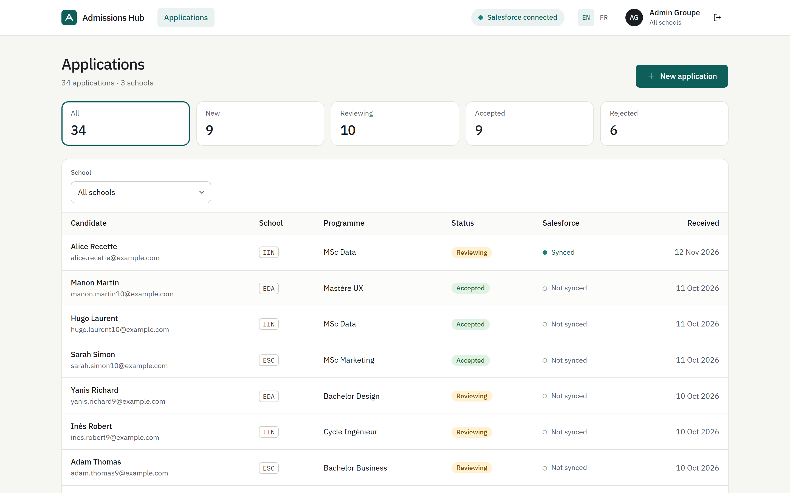
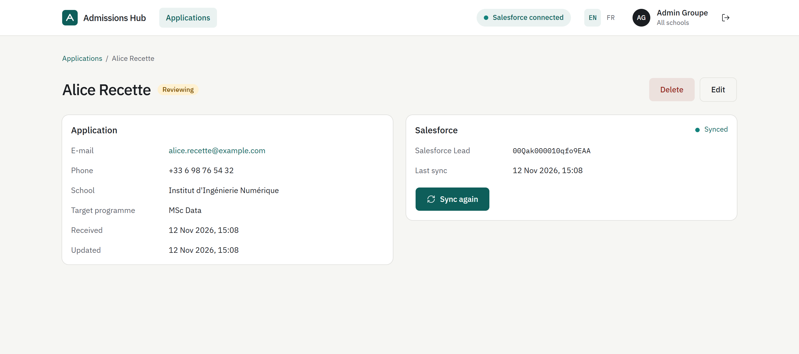
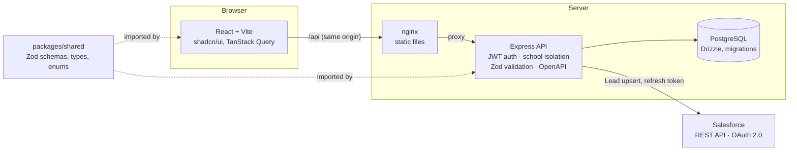

# Admissions Hub

**English** · [Français](README.fr.md)

Internal portal that gathers the applications of several schools and syncs them with Salesforce.
Each school administrator only sees their own school; the group administrator sees everything and pushes candidates to Salesforce as Leads.

[](https://github.com/Lachetquentin/admissions-hub/actions/workflows/ci.yml)

**Demo: <https://admissions-hub.onrender.com>** — `groupe@admissions.test` / `admissions-demo`
(or `esc@`, `iin@`, `eda@admissions.test` for a school administrator). Salesforce is disabled there;
the first request can take ~30 s (free hosting wakes up from sleep).





## Features

- **Multi-school**: roles `GROUP_ADMIN` (every school) and `SCHOOL_ADMIN` (their own school). Isolation is enforced by the API: a school administrator asking for another school's application gets **404**.
- **Applications**: paginated list, per-status counters that double as filters, school filter, create, edit, delete with confirmation. The front end and the API validate with the same Zod schemas.
- **Salesforce**: org connection through the OAuth 2.0 Web Server Flow (PKCE), tokens encrypted at rest, automatic refresh, idempotent sync of each application to a **Lead**, readable Salesforce errors.
- **Bilingual**: English and French UI (react-i18next), browser language by default, remembered EN / FR switcher.
- **Documented API**: OpenAPI 3.1 generated from the Zod schemas, Swagger UI on `/docs`.

## Architecture



Syncing an application follows the state machine `NOT_SYNCED → PENDING → SYNCED | FAILED`,
documented in [`docs/STATE_MACHINES.md`](docs/STATE_MACHINES.md).

## Run locally

Requirements: Docker. For development: Node.js 22+ (24 recommended).

**All in one** (migrations and demo data included):

```bash
docker compose up --build
```

→ <http://localhost:8080>. The demo accounts are listed on the login page.

**Development** (hot reload):

```bash
cp .env.example .env
docker compose up -d db
npm install
npm run db:migrate && npm run db:seed
npm run dev
```

→ front end on <http://localhost:5173>, API on <http://localhost:3000> (Swagger: <http://localhost:3000/docs>).

## Set up Salesforce

Summary (full guide, field mapping and troubleshooting: [`docs/SALESFORCE.md`](docs/SALESFORCE.md)):

1. Create a free [Developer Edition](https://developer.salesforce.com/signup) org.
2. Setup → **External Client App Manager** → new app with OAuth enabled, callback
   `http://localhost:3000/api/integrations/salesforce/callback`, scopes `api` and `refresh_token, offline_access`.
3. In `.env`: `SALESFORCE_ENABLED=true`, `SALESFORCE_CLIENT_ID`, `SALESFORCE_CLIENT_SECRET`,
   `TOKEN_ENCRYPTION_KEY` (32 bytes, base64). The API refuses to start if a value is missing.
4. Log in as `groupe@admissions.test` → header **Connect** → allow access in Salesforce.
5. Open an application → **Sync**: the Lead shows up in Salesforce (Company = school).

## Quality

| Command                 | Purpose                                                                   |
| ----------------------- | ------------------------------------------------------------------------- |
| `npm run lint`          | ESLint (TypeScript, React Hooks rules)                                    |
| `npm run typecheck`     | `tsc --noEmit` across the three workspaces                                |
| `npm test`              | Vitest: unit + Supertest integration tests against a test PostgreSQL base |
| `npm run test:coverage` | Coverage reports (HTML in `*/coverage/`)                                  |

GitHub Actions CI runs lint, typecheck, tests with coverage (PostgreSQL service) and build on every PR.
API coverage threshold: 85 % (currently ~96 % of lines). The tests make no network call to Salesforce:
the client sits behind an interface and is mocked.

## Technical choices

| Choice                                          | Why                                                                                                                                         |
| ----------------------------------------------- | ------------------------------------------------------------------------------------------------------------------------------------------- |
| **npm workspaces monorepo** + `packages/shared` | One Zod schema per entity: form validation, API validation and OpenAPI docs cannot drift apart.                                             |
| **Drizzle** over Prisma                         | TypeScript schema, readable SQL migrations, no binary engine: small Docker image and fast CI.                                               |
| **Isolation in the API** (`schoolScope`)        | The school filter is added to every SQL query; the front end is never a security boundary. 404 rather than 403 so nothing leaks.            |
| **OAuth with PKCE and a signed `state`**        | The `state` is a short-lived JWT bound to the admin who starts the connection, carrying the encrypted PKCE verifier: no server session.     |
| **AES-256-GCM encrypted tokens**                | The refresh token grants access to the org: never stored in clear text.                                                                     |
| **Sync transitions guarded in SQL**             | `UPDATE … WHERE sync_status IN (allowed states)`: two concurrent syncs cannot start together.                                               |
| **Injectable Salesforce client**                | `createApp({ salesforce })`: a mock in tests, the HTTP client in production.                                                                |
| **shadcn/ui + Tailwind v4**                     | Accessible components (Radix) on a custom charter: every tone is a CSS token, no hard-coded colour.                                         |
| **i18n with typed dictionaries**                | French is the reference dictionary and English must have the same keys (checked by `tsc`); shared schemas emit message keys, not sentences. |
| **Render** for the demo                         | Free Docker service, PostgreSQL and static site described in one `render.yaml`, see [`docs/DEPLOY.md`](docs/DEPLOY.md).                     |

## Structure

```
apps/api        Express API (auth, schools, applications, salesforce modules)
apps/web        React front end (pages, hooks, components, shadcn/ui, i18n)
packages/shared Shared Zod schemas, types and enums
docs/           State machines, Salesforce, deployment, out-of-scope ideas
```

Ideas deliberately left out: [`docs/IDEAS.md`](docs/IDEAS.md).
