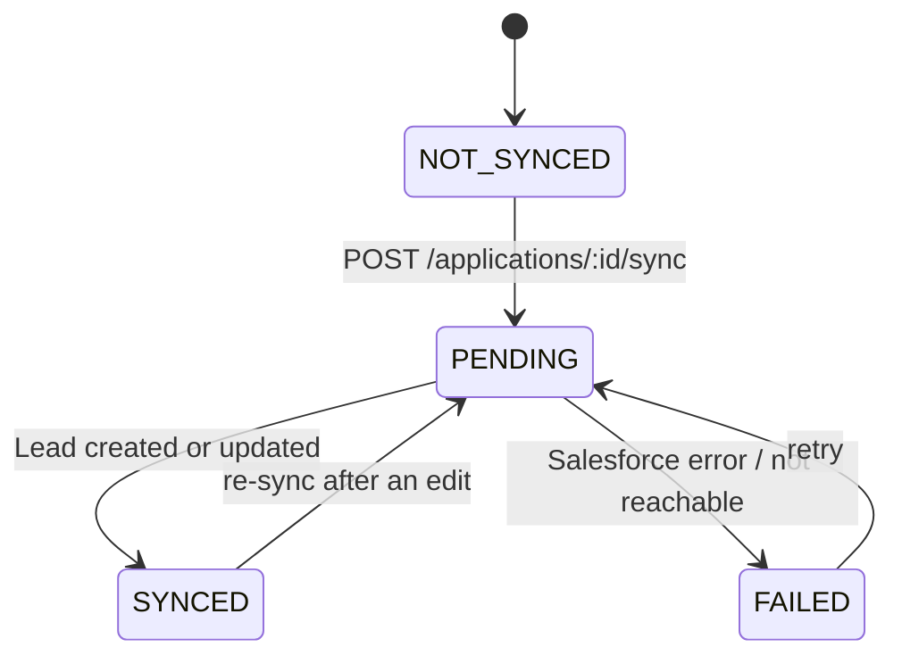

# State machines

## Salesforce sync status (per application)

Column `applications.sync_status`, enum `SyncStatus` in `packages/shared/src/enums.ts`.
Transitions are defined once in `apps/api/src/lib/syncStateMachine.ts` and covered by
`syncStateMachine.test.ts` (every valid pair accepted, every other pair rejected).

| From \ To  | NOT_SYNCED | PENDING | SYNCED | FAILED |
| ---------- | :--------: | :-----: | :----: | :----: |
| NOT_SYNCED |     –      |   ✅    |   ❌   |   ❌   |
| PENDING    |     ❌     |   ❌    |   ✅   |   ✅   |
| SYNCED     |     ❌     |   ✅    |   ❌   |   ❌   |
| FAILED     |     ❌     |   ✅    |   ❌   |   ❌   |

Invalid transitions answer **409 `INVALID_SYNC_TRANSITION`** with `details: { from, to }`.

### Guarantees

- **Atomic start.** Moving to `PENDING` is a single `UPDATE … WHERE sync_status IN (sources of PENDING)`.
  Two concurrent syncs of the same application cannot both start: the second gets 409.
- **Settled fields.**
  - `SYNCED`: `salesforce_id` is set, `last_sync_error` is null, `last_sync_at` is the success time.
  - `FAILED`: `last_sync_error` holds a readable message, `last_sync_at` is the attempt time,
    `salesforce_id` keeps the previous Lead id if there was one.
- **Idempotent upsert.** A sync reuses `salesforce_id` (PATCH the Lead). If Salesforce no longer
  has that Lead (deleted), a new Lead is created and its id replaces the old one.

### Known limit

A process crash between `PENDING` and the final update leaves the application in `PENDING`,
which then refuses new syncs. Recovering stale `PENDING` rows is noted in `docs/IDEAS.md`.

## Application business status

`applications.status`: `NEW`, `REVIEWING`, `ACCEPTED`, `REJECTED`. Admins may set any status
(the form is a free choice, corrections included), so there is no transition guard on it.
